# Jira_Slack

- [Jira와 Slack 연동](#jira와-slack-연동)
- [GitHub Actions 워크플로 만들기](#github-actions-워크플로-만들기)
- [Slack에 Jira Cloud 설치](#slack에-jira-cloud-설치)
- [Jira 프로젝트 연결](#jira-프로젝트-연결)
- [Slack에서 이슈 생성](#slack에서-이슈-생성)
- [이슈와 브랜치 자동 생성](#이슈와-브랜치-자동-생성)

 

---

### Jira와 Slack 연동

> Jira는 이슈(Epic, Task, Story, Bug 등)와 작업을 관리하는 도구이고, Slack은 팀 메신저다. Slack에 Jira Cloud 앱을 설치하면 Slack에서 `/jira` 명령으로 이슈를 만들고 알림을 받을 수 있다. 여기에 GitHub Actions를 더하면 Jira에서 이슈가 만들어질 때 GitHub 이슈와 브랜치까지 자동으로 만들어진다.

 

| **도구** | **역할** |
| --- | --- |
| Jira | 이슈 관리. 이 실습의 프로젝트는 `내 소프트웨어 팀(KAN)` |
| Slack | 팀 메신저. Jira Cloud 앱으로 이슈 생성과 알림 |
| GitHub Actions | Jira 이슈 생성 신호(`repository_dispatch`)를 받아 GitHub 이슈와 브랜치 생성 |

---

### GitHub Actions 워크플로 만들기

> 연동할 저장소(`jira_sync`)의 `Actions` 탭에서 `Choose a workflow` 화면이 나오면 `Simple workflow`의 `Configure`를 눌러 새 워크플로 파일을 만든다. 파일 경로는 `.github/workflows/jira-automation.yml`이고, 편집기에 워크플로 내용을 붙여 넣고 `Commit changes...`로 저장한다.

 

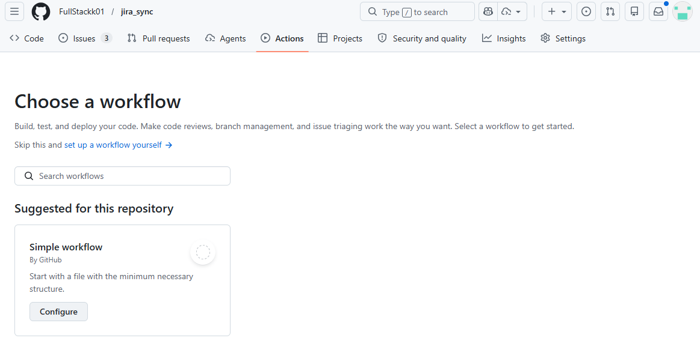

 

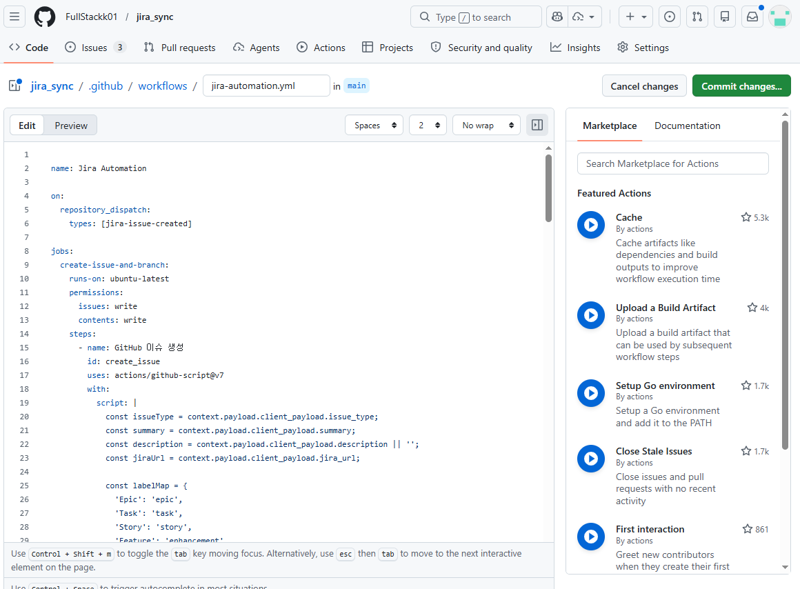

 

**워크플로 단계**

| **단계** | **설명** |
| --- | --- |
| 트리거 | `repository_dispatch`의 `jira-issue-created` 이벤트를 받으면 실행 |
| GitHub 이슈 생성 | `[타입] 제목` 형식으로 이슈를 만들고 타입에 맞는 라벨(`epic`, `task`, `story`, `enhancement`, `bug`)을 붙인다 |
| Jira 링크 추가 | Jira REST API(`/rest/api/3/issue/이슈키/remotelink`)로 Jira 이슈에 GitHub 이슈 링크를 추가한다 |
| 브랜치 생성과 연결 | `타입/이슈키-제목` 이름으로 `develop`에서 브랜치를 만들고 `createLinkedBranch`로 이슈와 연결한다. 제목은 공백을 `-`로 바꾸고 특수문자를 제거해 50자까지 쓴다 |

 

Jira 링크 추가에는 저장소 Secrets에 `JIRA_BASE_URL`, `JIRA_EMAIL`, `JIRA_API_TOKEN`을 등록해야 한다. 값은 워크플로 파일에 직접 쓰지 않고 `${{ secrets.이름 }}`으로 참조한다. 이 값이 없으면 Jira 링크 추가 단계만 건너뛴다.

 

- 예제 코드: [Jira 자동화 워크플로](./jira-automation.yml)

---

### Slack에 Jira Cloud 설치

> Slack에서 로그인하고 새 워크스페이스를 만든 뒤, `더보기`의 `앱`에서 추천 앱 목록의 `Jira Cloud`를 `설치`한다. 설치하면 권한 요청 화면이 나오고, 워크스페이스를 확인하고 `허용`을 누르면 Atlassian 계정과 연결된다.

 

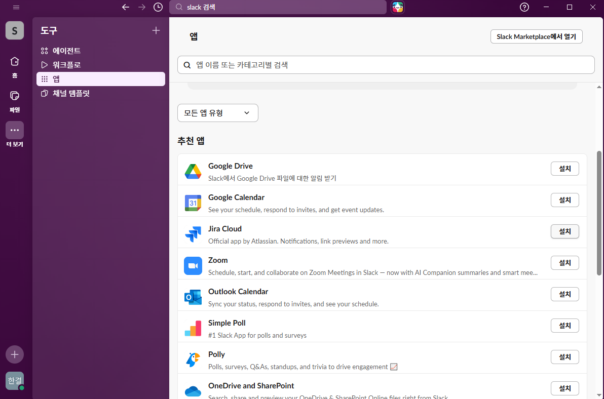

 

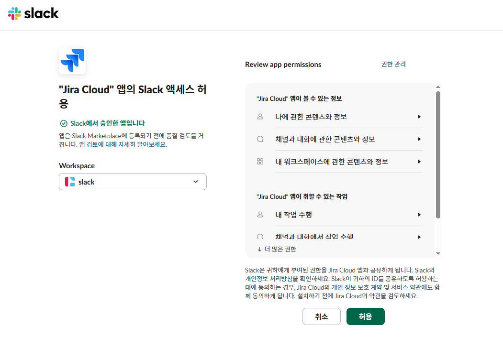

 

설치가 끝나면 Jira 앱이 환영 메시지를 보낸다. 이슈 만들기(`/jira create`), 프로젝트 연결(`/jira connect`), 개인 알림(`/jira notify`), 알림 관리(`/jira manage`), 도움말(`/jira help`)을 버튼으로도 쓸 수 있다.

 

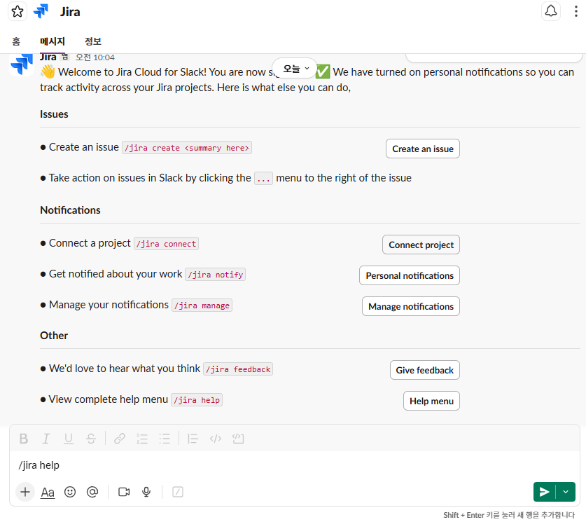

 

`/jira help`를 입력하면 사용할 수 있는 명령어를 보여준다.

 

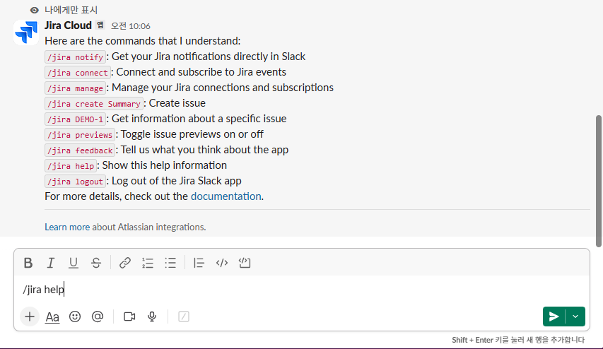

 

| **명령** | **설명** |
| --- | --- |
| `/jira notify` | Jira 알림을 Slack에서 바로 받기 |
| `/jira connect` | Jira 이벤트를 구독할 프로젝트 연결 |
| `/jira manage` | Jira 연결과 구독 관리 |
| `/jira create 제목` | 이슈 생성 |
| `/jira DEMO-1` | 특정 이슈 정보 확인 |
| `/jira previews` | 이슈 미리보기 켜고 끄기 |
| `/jira feedback` | 앱에 대한 의견 보내기 |
| `/jira help` | 도움말 |
| `/jira logout` | Jira Slack 앱에서 로그아웃 |

---

### Jira 프로젝트 연결

> 알림을 받을 Slack 채널에서 `Connect project`를 눌러 Jira 사이트, 프로젝트, 채널을 정하고 `Connect`를 누른다. 처음에는 사이트를 고르지 않은 상태(`Jira site...`)이고, 이미 개인 알림을 받는 중이면 `Modify` 버튼이 함께 나온다.

 

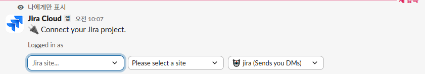

 

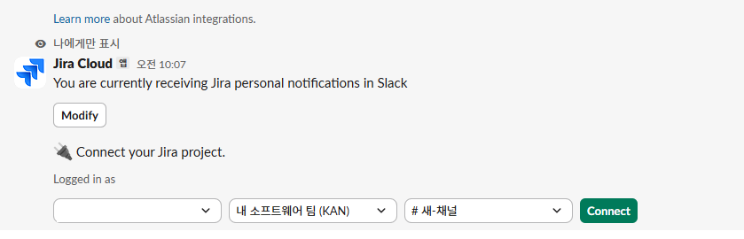

 

연결되면 `You have connected 프로젝트 to #채널` 메시지가 나오고, 채널에는 프로젝트 연결이 추가되었다는 알림이 남는다. 이후 이 프로젝트에 이슈가 만들어지면 채널에 알림이 온다.

 

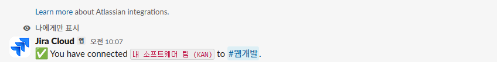

 

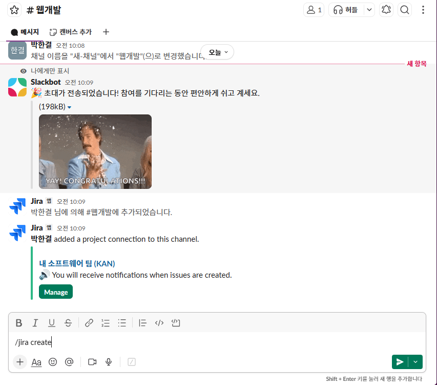

 

---

### Slack에서 이슈 생성

> 채널 입력창에 `/jira create`를 입력하면 이슈 생성 창이 열린다. `Site`, `Project`, `Issue type`(Epic, Task 등)을 고르고 `Summary`에 제목을 쓴 뒤 `Description`에 내용을 입력하고 `Submit`을 누른다. 설명에 `-[ ] 할일1`처럼 쓰면 체크리스트가 된다.

 

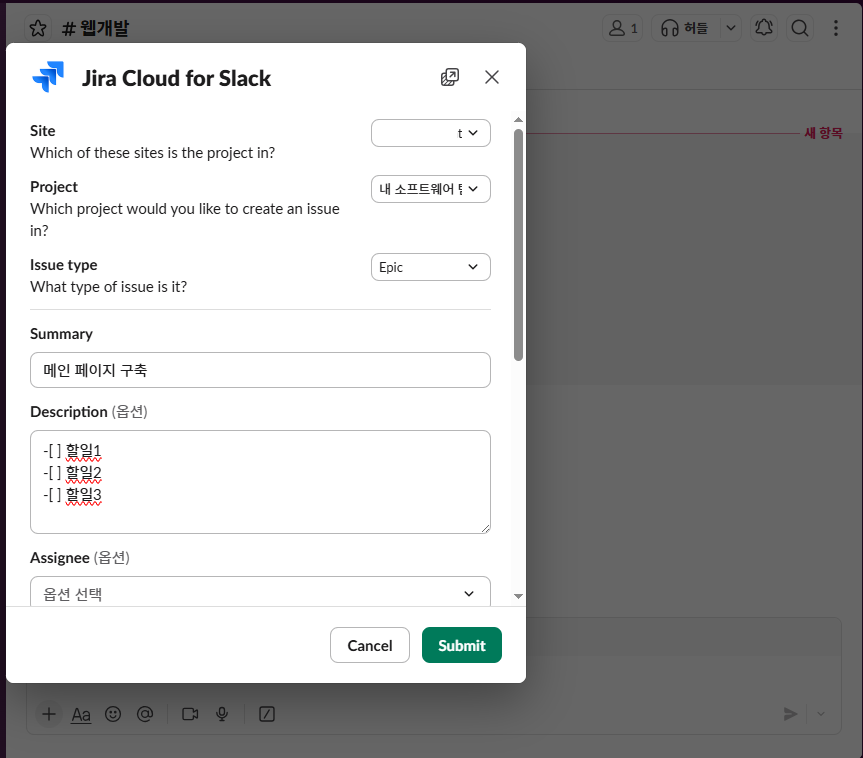

 

Jira 보드의 `내 소프트웨어 팀` 프로젝트에 이슈가 만들어진다.

 

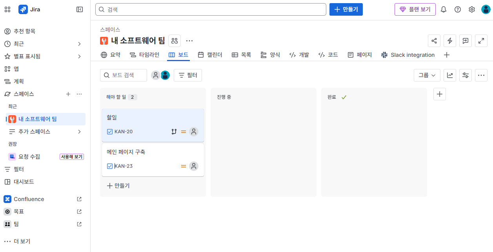

 

---

### 이슈와 브랜치 자동 생성

> 워크플로가 설정되어 있으면 Jira에서 이슈를 만들 때 GitHub에 이슈(`[TASK] 메인 페이지 구축`)가 생기고, 본문에 Jira 링크와 체크리스트가 들어간다. 이어서 `task/KAN-23-메인-페이지-구축` 같은 브랜치가 만들어져 이슈에 연결되고, 이슈에 `브랜치 생성 완료` 댓글이 달린다.

 

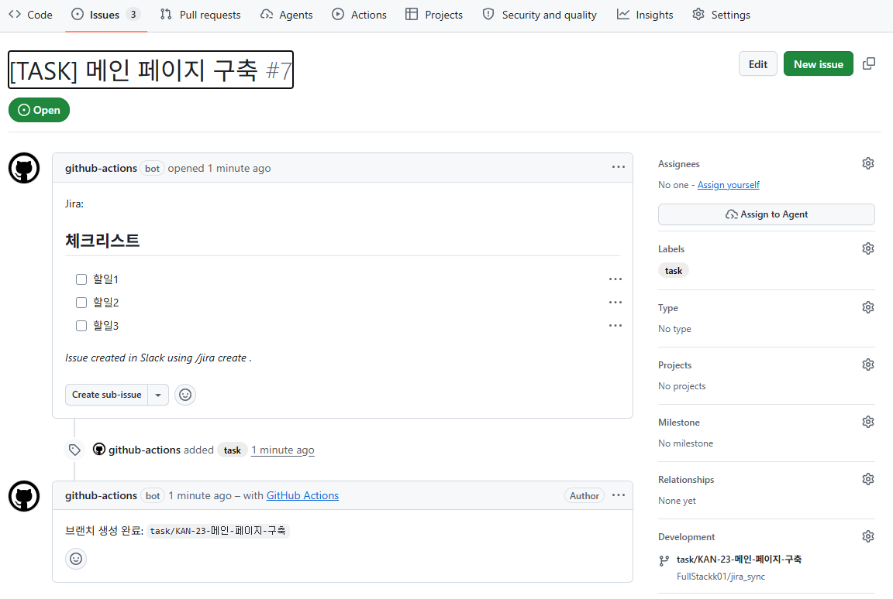

 

 

---

 

**Jira_Slack 요약**

<aside>

> Slack에 Jira Cloud 설치 후 /jira connect, /jira create, /jira help  
GitHub Actions: Jira 이슈 생성 시 GitHub 이슈, Jira 링크, 브랜치 자동 생성  
토큰과 계정은 Secrets로 관리

</aside>

 

### Link
[Jira Cloud for Slack](https://www.atlassian.com/ko/software/jira/guides/slack)  
[GitHub Actions 문서](https://docs.github.com/ko/actions)
