# Eclipse_Servlet

- [Dynamic Web Project 생성](#dynamic-web-project-생성)
- [서블릿 작성](#서블릿-작성)
- [web.xml 생성](#webxml-생성)
- [외부 라이브러리 추가](#외부-라이브러리-추가)

 

---

### Dynamic Web Project 생성

> 서블릿(Servlet)은 Java로 웹 요청을 처리하는 프로그램이다. Eclipse에서 `File, New, Dynamic Web Project`를 선택해 서블릿을 개발할 프로젝트를 만든다.

 

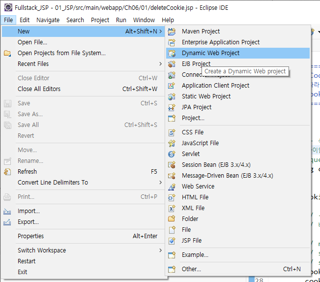

 

| **항목** | **값** |
| --- | --- |
| Project name | `02_SERVLET_INIT` |
| Target runtime | `Apache Tomcat v9.0` |
| Dynamic web module version | `4.0` |
| Configuration | `Default Configuration for Apache Tomcat v9.0` |

 

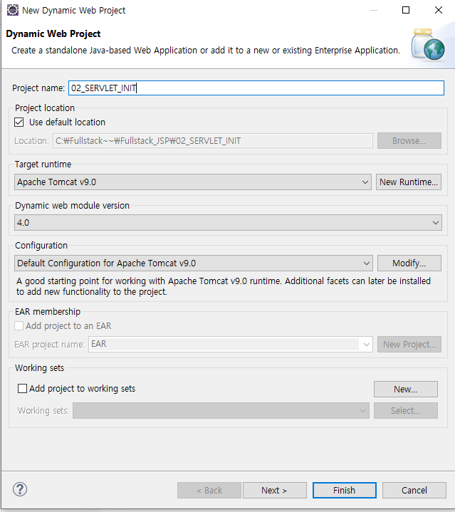

 

프로젝트가 만들어지면 `Deployment Descriptor`, `JAX-WS Web Services`, `Java Resources`, `build`, `src`가 보인다.

 

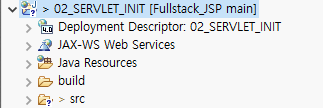

 

---

### 서블릿 작성

> `HttpServlet`을 상속한 클래스를 만들고 클래스 위에 `@WebServlet("/주소")`를 붙이면 그 주소로 요청이 왔을 때 이 서블릿이 실행된다. 예제는 `C01Servlet_Test` 클래스에 `@WebServlet("/TEST_01")`을 붙였고 `javax.servlet.annotation.WebServlet`, `javax.servlet.http.HttpServlet`을 import한다.

 

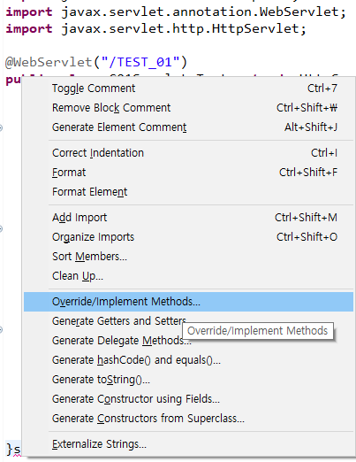

 

코드 편집기에서 오른쪽 마우스, `Source`, `Override/Implement Methods...`를 선택하면 상속받은 메서드 중 재정의할 것을 고르는 창이 열린다. 예제는 `HttpServlet`과 `GenericServlet`의 메서드 26개 중 서블릿 생명주기 메서드 3개(`init`, `service(ServletRequest, ServletResponse)`, `destroy`)를 선택했다.

 

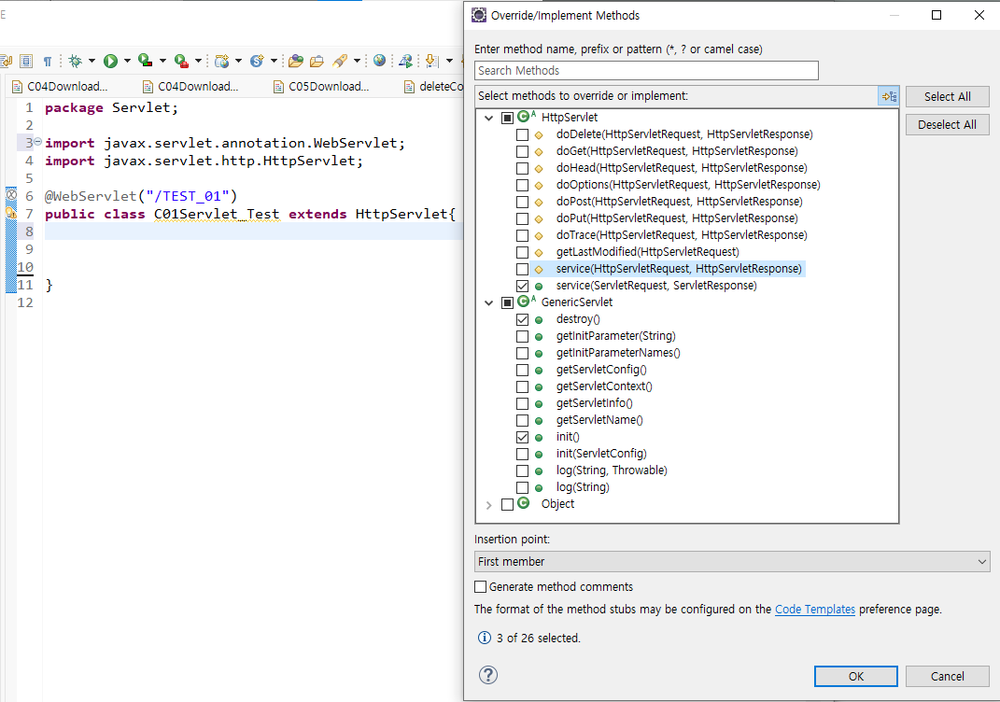

 

| **메서드** | **실행 시점** |
| --- | --- |
| `init()` | 서블릿이 처음 만들어질 때 한 번 |
| `service()` | 요청이 올 때마다 |
| `destroy()` | 서블릿이 사라질 때(서버 종료, 재시작) 한 번 |

 

각 메서드 안에 `System.out.println`으로 실행 시점을 출력해 서버 콘솔에서 확인한다.

 

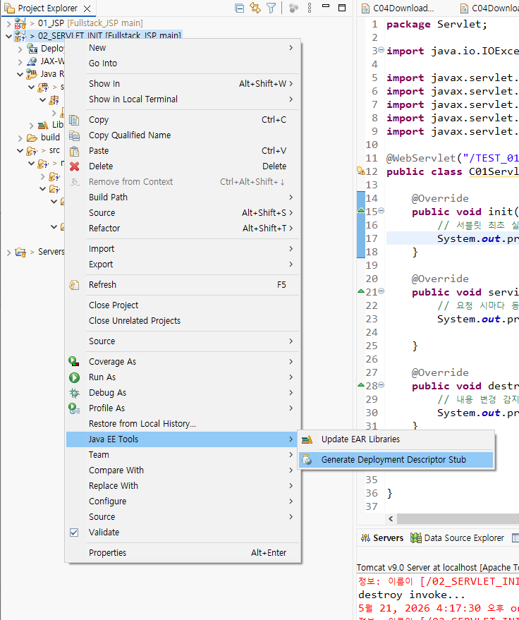

 

**Source 메뉴**

`Alt+Shift+S`로도 여는 `Source` 메뉴에는 코드 편집 기능이 모여 있다.

| **기능** | **단축키, 설명** |
| --- | --- |
| Toggle Comment | `Ctrl+7`. 주석 처리와 해제 |
| Correct Indentation | `Ctrl+I`. 들여쓰기 정리 |
| Format | `Ctrl+Shift+F`. 코드 정렬 |
| Add Import, Organize Imports | `Ctrl+Shift+M`, `Ctrl+Shift+O`. import 추가와 정리 |
| Override/Implement Methods | 상속받은 메서드 재정의 |
| Generate Getters and Setters | getter와 setter 자동 생성 |
| Generate hashCode() and equals(), toString() | 해당 메서드 자동 생성 |
| Generate Constructor using Fields | 필드로 생성자 만들기 |

 

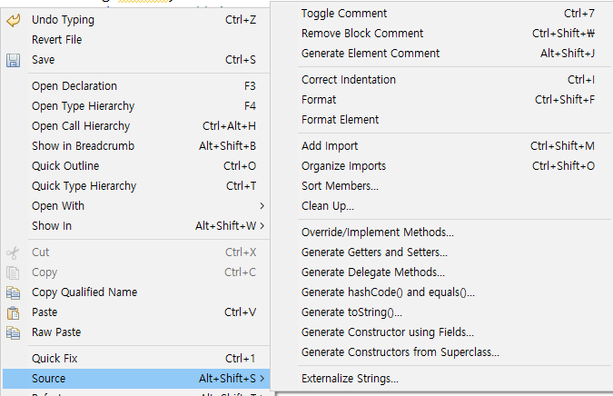

 

---

### web.xml 생성

> `web.xml`은 웹 애플리케이션의 설정 파일(배포 서술자)이다. 어노테이션을 쓰면 서블릿 주소 연결에는 필요 없지만, 프로젝트에서 오른쪽 마우스, `Java EE Tools`, `Generate Deployment Descriptor Stub`을 선택하면 `src/main/webapp/WEB-INF` 아래에 만들어진다.

 

 

생성된 `web.xml`에는 프로젝트 이름(`display-name`)과 첫 화면 후보 파일 목록(`welcome-file-list`)이 들어 있다. `index.html`, `index.htm`, `index.jsp`, `default.html` 등을 차례로 찾는다.

 

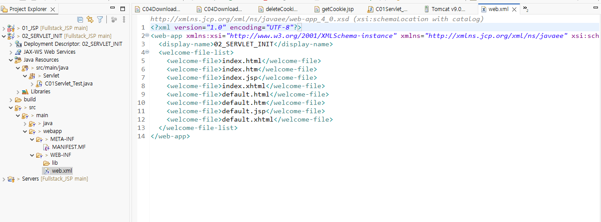

 

---

### 외부 라이브러리 추가

> 서블릿 프로젝트에서 쓰는 외부 라이브러리(jar)는 [Maven Repository](https://mvnrepository.com/)에서 받아 `src/main/webapp/WEB-INF/lib` 폴더에 넣는다. 이 폴더의 jar는 실행할 때 자동으로 클래스 경로에 포함된다.

 

| **순서** | **설명** |
| --- | --- |
| 1 | 검색 사이트에서 `maven repository`를 검색해 mvnrepository.com에 접속 |
| 2 | 라이브러리 이름으로 검색하고 결과에서 라이브러리 선택 |
| 3 | 버전 목록에서 버전을 선택하고 `Files`의 `jar`를 다운로드 |
| 4 | 다운로드한 jar를 `WEB-INF/lib`에 복사 |

 

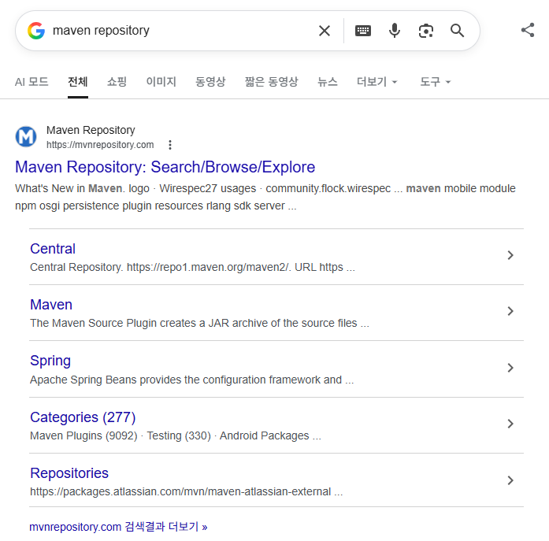

 

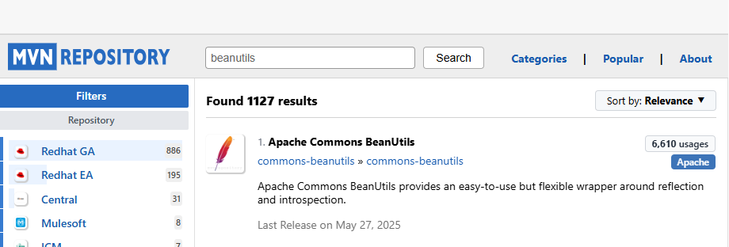

 

**commons-beanutils**

`beanutils`로 검색해 `Apache Commons BeanUtils`(리플렉션을 감싸 객체의 속성을 쉽게 다루는 라이브러리)를 선택하고 버전 `1.11.0`의 jar(241 KB)를 받는다.

 

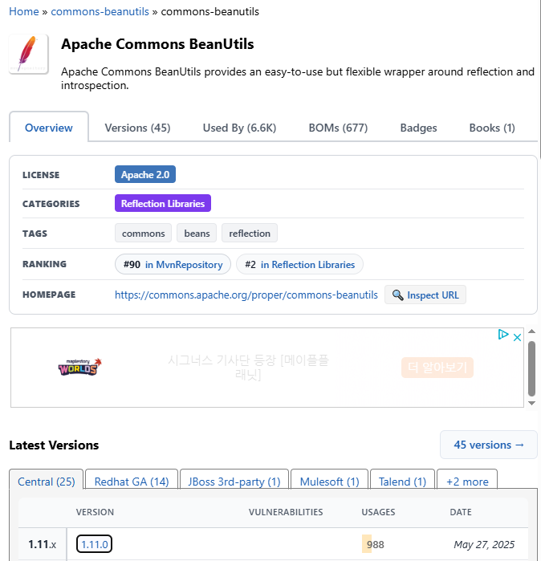

 

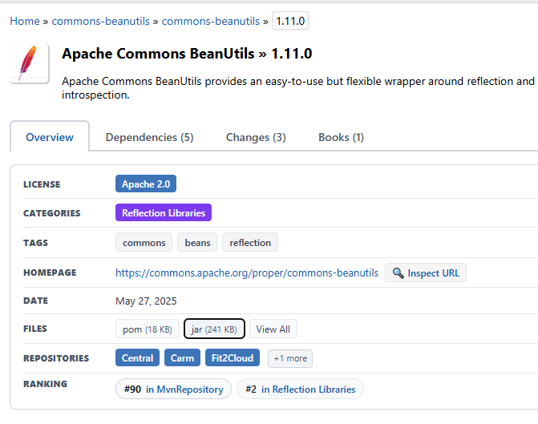

 

**commons-logging**

`apache commons Logging`으로 검색해 `Apache Commons Logging`(여러 로깅 도구를 하나의 방식으로 쓰게 해 주는 어댑터)을 선택하고 버전 `1.3.6`의 jar(72 KB)를 받는다.

 

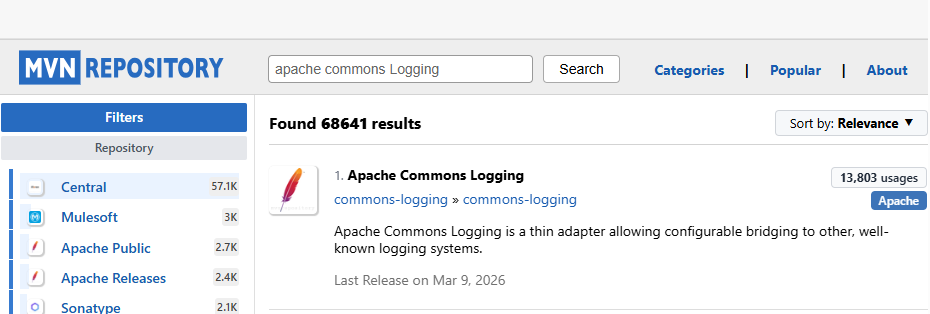

 

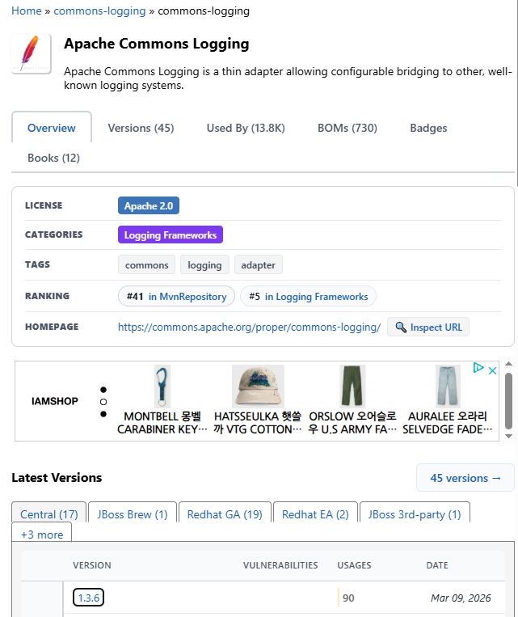

 

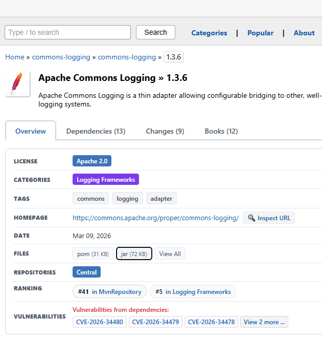

 

**commons-lang**

`commons lang`으로 검색해 `Commons Lang`(`java.lang` 관련 유틸리티 클래스 모음)을 선택하고 버전 `2.6`의 jar(277 KB)를 받는다. 새 버전은 `commons-lang3`로 옮겨졌다(Relocated)고 표시된다.

 

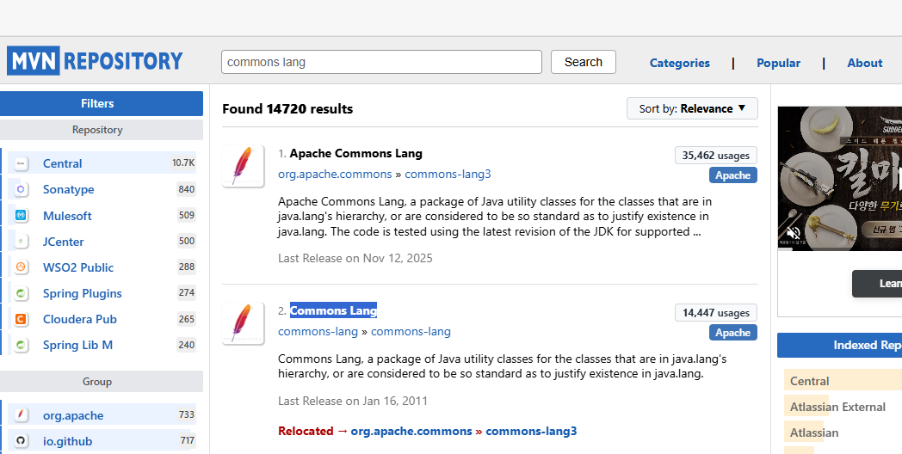

 

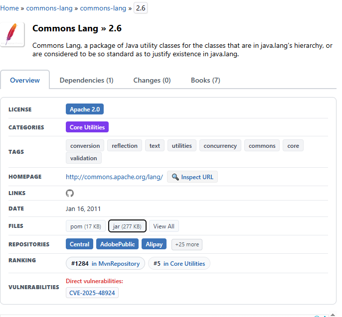

 

받은 jar 3개(`commons-beanutils-1.11.0.jar`, `commons-lang-2.6.jar`, `commons-logging-1.3.6.jar`)가 다운로드 폴더에 있다. 이 파일들을 `WEB-INF/lib`에 넣으면 Eclipse의 프로젝트에서 `lib` 아래에 보인다.

 

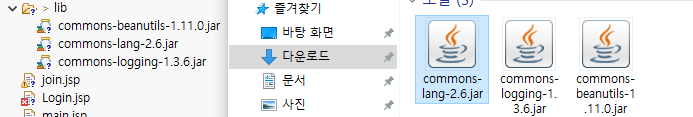

 

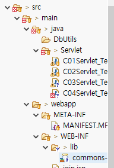

 

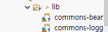

 

 

---

 

**Eclipse_Servlet 요약**

<aside>

> Dynamic Web Project: Tomcat v9.0, 모듈 버전 4.0  
@WebServlet으로 주소 연결, init, service, destroy 생명주기  
Generate Deployment Descriptor Stub으로 web.xml 생성  
외부 jar는 Maven Repository에서 받아 WEB-INF/lib에 추가

</aside>

 

### Link
[Jakarta Servlet](https://jakarta.ee/specifications/servlet/)  
[Maven Repository](https://mvnrepository.com/)
