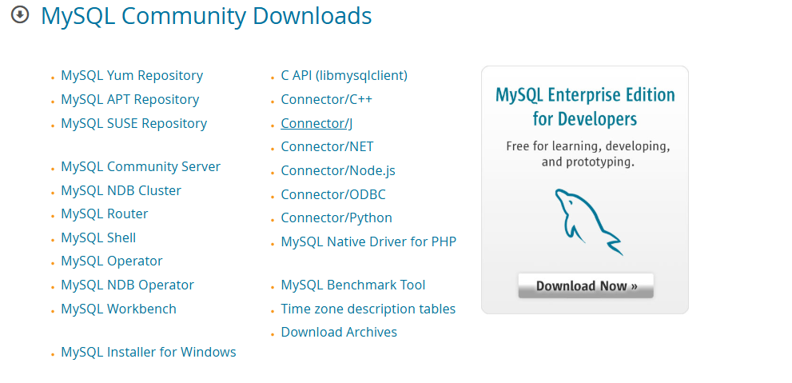
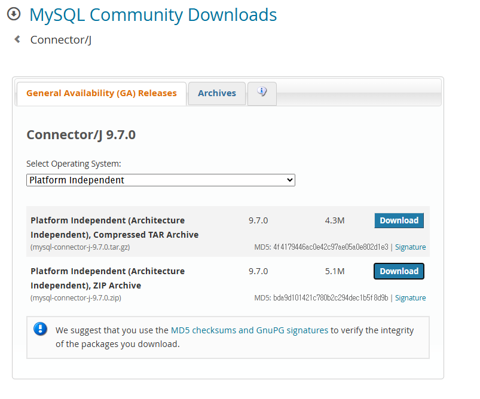
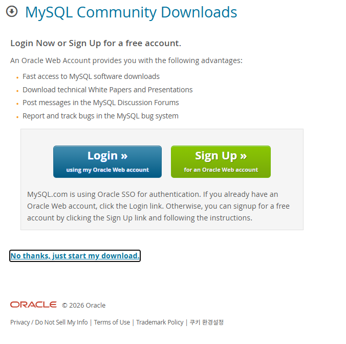
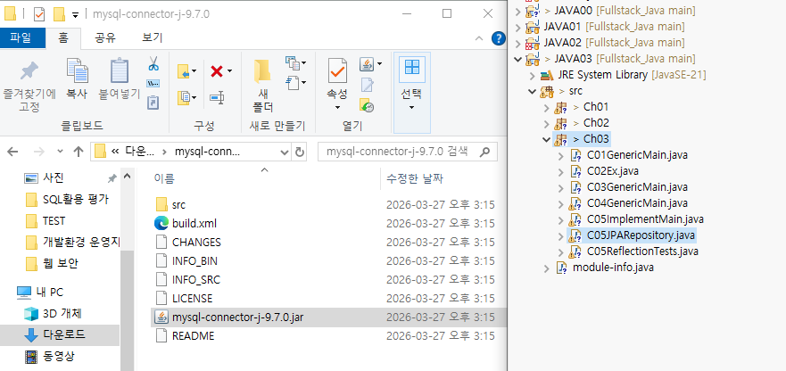
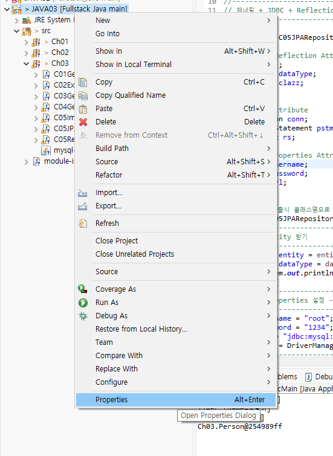
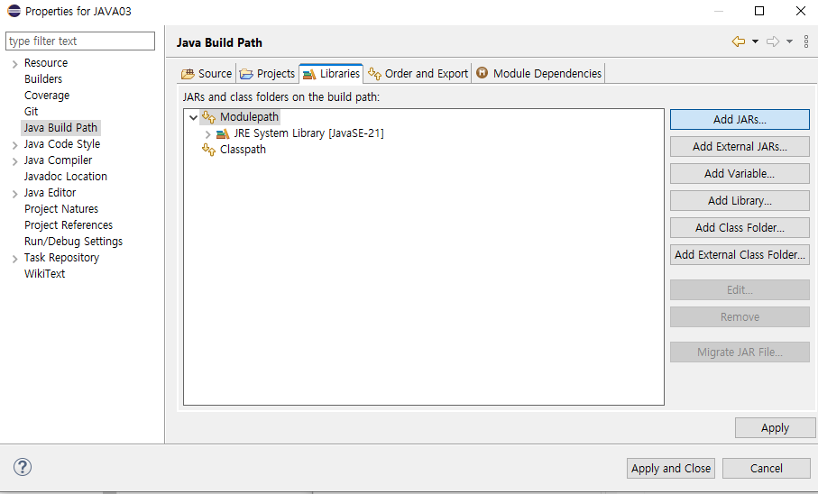
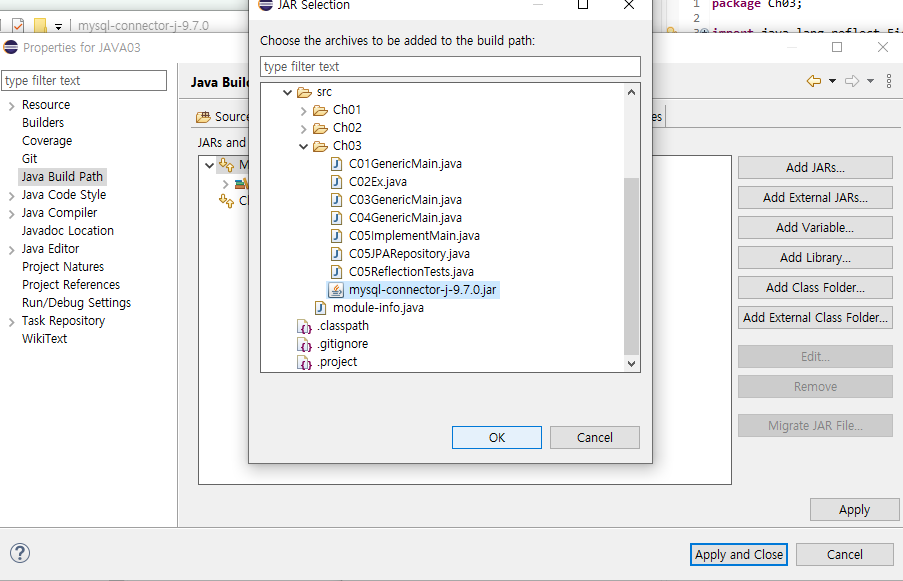
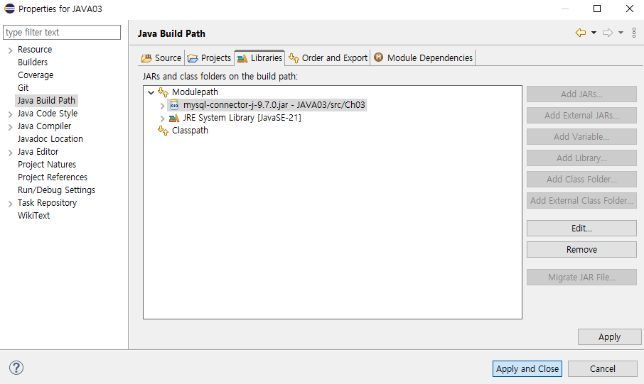
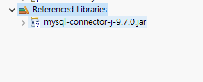

# MySQL_Driver

- [MySQL Connector/J 다운로드](#mysql-connectorj-다운로드)
- [프로젝트에 jar 추가](#프로젝트에-jar-추가)

 

---

### MySQL Connector/J 다운로드

> Java 프로그램에서 MySQL에 접속(JDBC)하려면 MySQL 드라이버인 Connector/J(jar 파일)가 필요하다. [MySQL Community Downloads](https://dev.mysql.com/downloads/)에서 `Connector/J`를 선택한다.

 

 

버전은 `9.7.0`이고 `Select Operating System`은 `Platform Independent`를 선택한다. TAR(4.3M)과 ZIP(5.1M) 압축 파일이 있는데 ZIP의 `Download`를 누른다.

 

 

로그인 안내 화면이 나오면 로그인하지 않고 아래의 `No thanks, just start my download.`를 눌러 받는다.

 

 

---

### 프로젝트에 jar 추가

> 압축을 풀면 `src`, `build.xml`, `CHANGES`, `LICENSE`, `README` 등과 함께 `mysql-connector-j-9.7.0.jar`가 있다. 이 jar가 JDBC 드라이버다. jar를 프로젝트(예제는 `JAVA03`의 `src/Ch03`)로 끌어다 놓고 Build Path에 추가한다.

 

 

**Build Path 설정**

| **순서** | **설명** |
| --- | --- |
| 1 | 프로젝트에서 오른쪽 마우스, `Properties`(`Alt+Enter`) 선택 |
| 2 | 왼쪽 목록에서 `Java Build Path`를 선택하고 `Libraries` 탭으로 이동. `Modulepath`와 `Classpath`가 보인다 |
| 3 | `Add JARs...`를 누르고 `JAR Selection` 창에서 프로젝트 안의 `mysql-connector-j-9.7.0.jar`(`src/Ch03`) 선택 후 `OK` |
| 4 | `Modulepath`에 `mysql-connector-j-9.7.0.jar - JAVA03/src/Ch03`이 나타나면 `Apply and Close` |

 

 

 

 

 

프로젝트에 `module-info.java`가 있어서 jar가 `Classpath`가 아니라 `Modulepath`에 추가된다. 추가가 끝나면 Package Explorer에 `Referenced Libraries`가 생기고 그 아래에 jar가 보인다.

 

 

 

---

 

**MySQL_Driver 요약**

<aside>

> Connector/J: Java에서 MySQL에 접속하는 JDBC 드라이버(jar)  
Platform Independent ZIP을 받아 jar를 프로젝트에 넣고 Java Build Path의 Libraries에 Add JARs  
Referenced Libraries에 보이면 완료

</aside>

 

### Link
[MySQL Connector/J](https://dev.mysql.com/doc/connector-j/en/)
